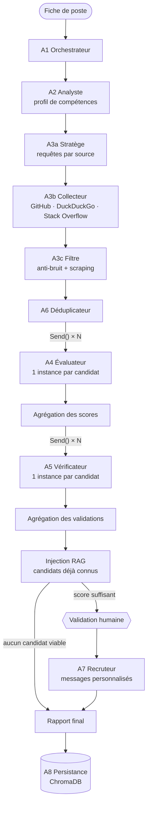
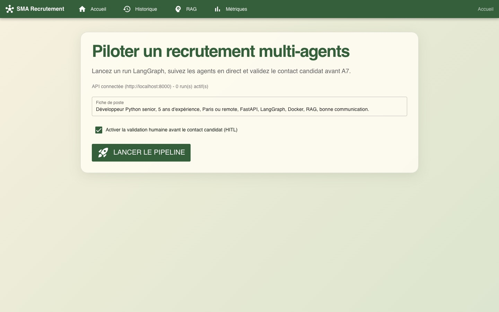
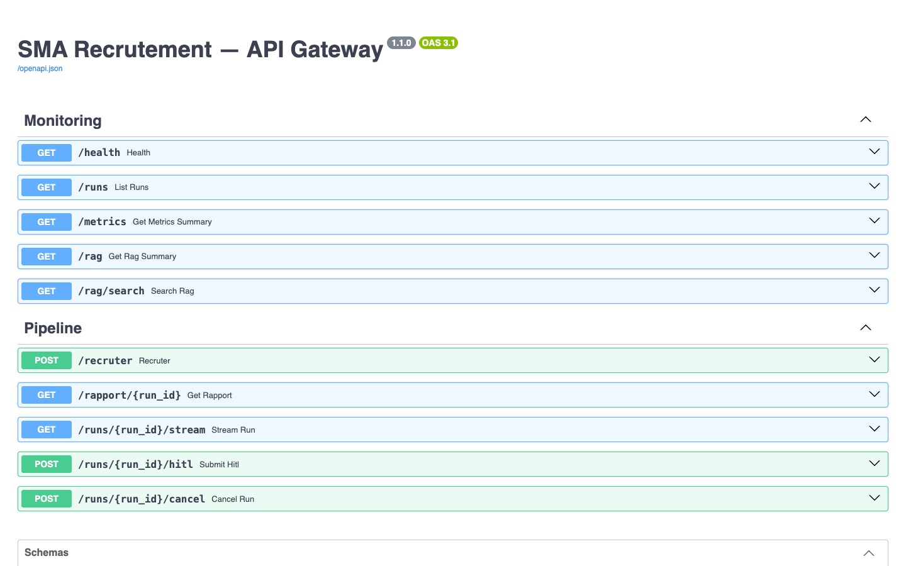

# Automated Recruitment Multi-Agent System


Système multi-agents (SMA) basé sur l'IA agentique pour automatiser la recherche et le contact de candidats développeurs. À partir d'une simple fiche de poste, le pipeline identifie, évalue et contacte les profils pertinents — avec validation humaine avant tout envoi.

> TER Master 1 Informatique — Université de Montpellier  
> Auteurs : Sofiane Hammar, Anouar Soufyani, Souad Hadji  
> Encadrant : M. Abdelhak-Djamel Seriai

---

## Fonctionnalités

- **Pipeline entièrement automatisé** : de la fiche de poste au rapport final
- **8 agents spécialisés** orchestrés par LangGraph avec parallélisation fan-out
- **Multi-sources** : GitHub, DuckDuckGo, Stack Overflow
- **RAG (mémoire vectorielle)** : historique des candidats via ChromaDB
- **Human-in-the-loop** : validation humaine avant contact des candidats
- **Double déploiement** : mode local LangGraph ou microservices Docker
- **113 tests automatisés** (pytest), dont une exécution complète du pipeline sans réseau

---

## Architecture

Graphe LangGraph tel que construit dans [`src/graph.py`](src/graph.py) :



- **Parallélisme** : A4 et A5 sont lancés en une instance par candidat (pattern `Send` de LangGraph), avec un nombre d'appels LLM simultanés borné.
- **Blackboard** : tous les agents partagent un état typé (`GraphState`), chacun écrivant dans ses propres champs.
- **Human-in-the-loop** : le graphe s'interrompt avant A7 ; l'utilisateur approuve, modifie ou rejette la liste des candidats à contacter.
- **Mémoire inter-runs** : les candidats évalués sont stockés dans ChromaDB et réutilisés pour des fiches de poste similaires (calibration, cache de scores, liste noire).

## Interface

| Interface web (NiceGUI) | API REST (FastAPI / Swagger) |
|---|---|
|  |  |

---

## Stack technique

| Couche | Technologies |
|---|---|
| Orchestration agents | LangGraph, LangChain |
| LLM | Groq API — gpt-oss-120b / gpt-oss-20b |
| API REST | FastAPI |
| Mémoire vectorielle | ChromaDB (RAG) |
| Sources candidats | GitHub API, DuckDuckGo, Stack Overflow API |
| Interface utilisateur | Web UI (port 8080) |
| Déploiement | Docker Compose — monolithique ou microservices |
| Tests | pytest — 113 tests |

---

## Installation

### Prérequis
- Python 3.10+
- Clé API Groq → [console.groq.com](https://console.groq.com)

```bash
git clone https://github.com/sofianeham34/Multi-agent-profile-recruitment.git
cd Multi-agent-profile-recruitment

cp .env.example .env
# Renseigner GROQ_API_KEY dans .env

python3 -m venv .venv && source .venv/bin/activate
pip install -r requirements.txt
./run_local.sh
```

| Service | URL |
|---|---|
| Interface web | http://localhost:8080 |
| API REST | http://localhost:8000 |

### Docker (microservices)
```bash
docker compose -f docker-compose.microservices.yml up --build
```

---

## Utilisation CLI

```bash
# Fiche de poste en argument direct
python -m src.main "Développeur Python senior, 5 ans d'expérience, Paris"

# Depuis un fichier
python -m src.main --fichier fiche_poste.txt

# Sans validation humaine
python -m src.main --no-interrupt "Data Scientist ML, remote"
```

---

## Tests

```bash
python3 -m pytest tests/ -v
```

---

## Structure

```
src/
├── agents/          # 8 agents spécialisés
├── tools/           # GitHub API, DuckDuckGo, Stack Overflow, RAG
├── ui/              # Interface web
├── graph.py         # Graphe LangGraph
├── api.py           # API Gateway FastAPI
└── state.py         # État partagé entre agents
services/            # Microservices Docker (1 par agent)
tests/               # 113 tests automatisés
```
