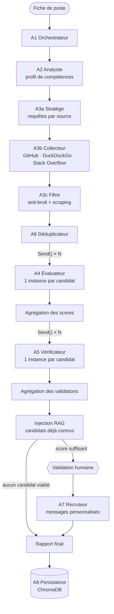
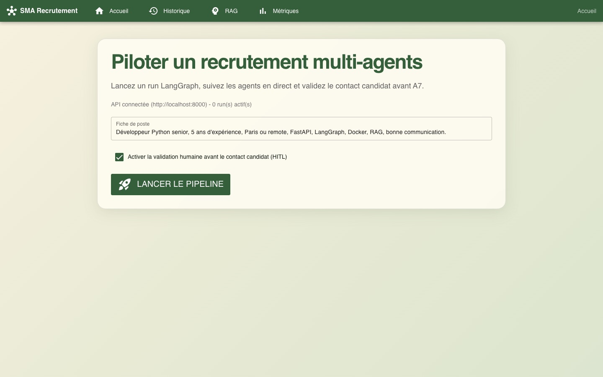
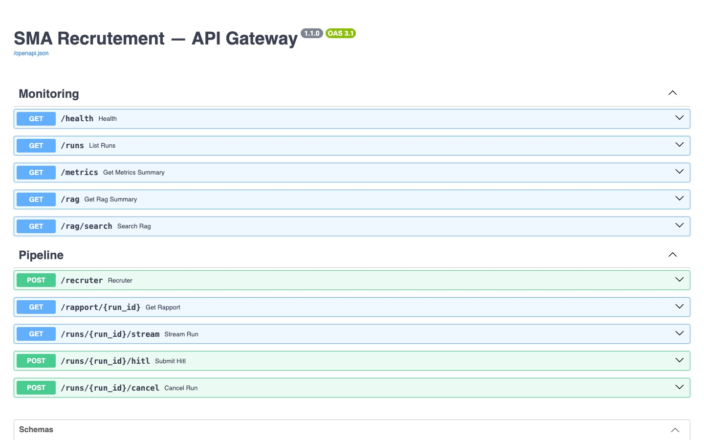

# Système multi-agents de recrutement automatisé


**À partir d'une simple fiche de poste, 8 agents IA coopèrent pour trouver, évaluer et préparer le contact de développeurs — avec un humain qui garde la décision finale.**

Système multi-agents (SMA) construit avec LangGraph : un agent analyse le besoin, d'autres cherchent des profils
sur GitHub, Stack Overflow et le web, les évaluent en parallèle, se contrôlent mutuellement, puis rédigent des
messages de contact personnalisés. Les candidats évalués alimentent une mémoire vectorielle qui améliore les
recherches suivantes.

> TER Master 1 Informatique — Université de Montpellier  
> Auteurs : Sofiane Hammar, Anouar Soufyani, Souad Hadji  
> Encadrant : M. Abdelhak-Djamel Seriai

---

## Fonctionnalités

- **Pipeline de bout en bout** : de la fiche de poste au rapport final et aux messages de contact personnalisés
- **8 agents spécialisés** orchestrés par LangGraph, avec évaluation et vérification en parallèle
- **Multi-sources** : API GitHub, API Stack Overflow, recherche web (DuckDuckGo) et scraping
- **Mémoire RAG** (ChromaDB) : historique des candidats réutilisé d'un recrutement à l'autre
- **Human-in-the-loop** : avant toute rédaction, l'utilisateur coche les candidats à retenir ; un message de contact est rédigé pour chacun, à copier (rien n'est envoyé automatiquement)
- **Interface web** : suivi des agents en direct, messages de contact prêts à copier, export du rapport (Markdown) et des candidats (CSV), historique avec suppression, mémoire RAG consultable et réinitialisable
- **API REST** et **CLI** pour lancer les mêmes recherches sans interface
- **Déploiement Docker** : monolithique ou un microservice par agent

## Défis techniques

| Problème | Solution mise en place |
|---|---|
| Les résultats de recherche contiennent surtout du bruit (offres d'emploi, articles, listes) | Agent filtre dédié (A3c) : élimination des URL non pertinentes, détection des pages agrégées, priorisation des profils individuels |
| Un LLM peut surévaluer un candidat | **Validation pair-à-pair** : A4 note, A5 contrôle indépendamment avec des règles métier (expérience, page non-candidat, adéquation minimale) |
| Un LLM note les compétences mais néglige le lieu | Règle de localisation appliquée en dernier : pas de statut `valide` sans ville demandée, France ou LinkedIn français dans le profil |
| Une décision humaine doit toujours l'emporter | L'état du graphe fonctionne en ajout : la dernière version de chaque candidat fait foi (routage, recruteur, rapport), testé de bout en bout |
| Un candidat validé hier ne correspond pas forcément à la fiche d'aujourd'hui | Avant réinjection depuis la mémoire, revérification déterministe face à la fiche courante (compétences, rôle, lieu, expérience) |
| Ne pas réévaluer un profil déjà écarté | Liste noire RAG limitée aux fiches similaires : ni scraping ni appel LLM pour un profil déjà jugé invalide |
| Trouver des candidats même sans profil « parfait » | **Routage absolu ou relatif** : contact au-dessus du seuil, sinon proposition des meilleurs profils viables |
| La mémoire ne doit pas biaiser un poste avec les scores d'un autre | **RAG calibré par fiche de poste** : les références ne sont utilisées que pour des fiches similaires (seuil de similarité), avec cache de scores et liste noire inter-runs |
| Les réponses d'un LLM ne sont pas toujours exploitables | Extraction JSON centralisée avec nouvelle tentative ; un candidat non évaluable est écarté, jamais noté au hasard |
| Les API externes et le LLM limitent le débit | Débit plafonné côté client (requêtes par seconde), parallélisme borné (`max_concurrency`), relances exponentielles sur les erreurs 429 |
| Ne pas dépendre d'un fournisseur de LLM | API au format « compatible OpenAI » : OpenRouter, Mistral, Groq, Ollama ou tout autre fournisseur se choisit dans le `.env`, sans toucher au code |

## Architecture

Graphe LangGraph tel que construit dans [`src/graph.py`](src/graph.py) :



- **Parallélisme** : A4 et A5 sont lancés en une instance par candidat (pattern `Send` de LangGraph), avec un nombre d'appels LLM simultanés borné.
- **Blackboard** : tous les agents partagent un état typé (`GraphState`), chacun écrivant dans ses propres champs.
- **Human-in-the-loop** : le graphe s'interrompt avant A7 ; l'utilisateur approuve, modifie ou rejette la liste des candidats à contacter.
- **Mémoire inter-runs** : les candidats évalués sont stockés dans ChromaDB et réutilisés pour des fiches de poste similaires (calibration, cache de scores, liste noire).

## Interface

| Interface web (NiceGUI) | API REST (FastAPI / Swagger) |
|---|---|
|  |  |

---

## Stack technique

| Couche | Technologies |
|---|---|
| Orchestration agents | LangGraph, LangChain |
| LLM | Tout fournisseur compatible OpenAI — OpenRouter par défaut (modèles gratuits), Mistral, Groq, Ollama… |
| API REST | FastAPI |
| Mémoire vectorielle | ChromaDB (RAG) |
| Sources candidats | GitHub API, DuckDuckGo, Stack Overflow API |
| Interface utilisateur | Web UI (port 8080) |
| Déploiement | Docker Compose — monolithique ou microservices |
| Tests | pytest — 165 tests |

---

## Installation

### Prérequis
- Python 3.10+
- Une clé d'API LLM. Par défaut, OpenRouter et ses modèles gratuits : compte sans carte bancaire,
  clé sur [openrouter.ai/settings/keys](https://openrouter.ai/settings/keys). Sans crédit acheté,
  rien ne peut être facturé : au-delà de la limite du jour, les requêtes sont refusées.

```bash
git clone https://github.com/sofianeham34/Multi-agent-profile-recruitment.git
cd Multi-agent-profile-recruitment

cp .env.example .env
# Renseigner OPENROUTER_API_KEY dans .env (ou un autre fournisseur, voir .env.example)

python3 -m venv .venv && source .venv/bin/activate
pip install -r requirements.txt
./run_local.sh
```

| Service | URL |
|---|---|
| Interface web | http://localhost:8080 |
| API REST | http://localhost:8000 |

### Docker (microservices)
```bash
docker compose -f docker-compose.microservices.yml up --build
```

### Démo publique (Render, offre gratuite)

`deploy/demo/` contient une image unique (API interne + interface exposée) en mode démo :
une recherche à la fois, 3 par jour, suppression désactivée. Sur Render : **New → Blueprint**,
choisir ce dépôt (`render.yaml`), puis saisir `OPENROUTER_API_KEY` quand Render la demande.

---

## Utilisation CLI

```bash
# Fiche de poste en argument direct
python -m src.main "Développeur Python senior, 5 ans d'expérience, Paris"

# Depuis un fichier
python -m src.main --fichier fiche_poste.txt

# Sans validation humaine
python -m src.main --no-interrupt "Data Scientist ML, remote"
```

---

## Qualité

```bash
python3 -m pytest tests/ -v
```

- **165 tests automatisés** : règles de filtrage et de vérification, déduplication, génération des requêtes, mémoire RAG, API REST, sources externes
- **Test du pipeline complet sans réseau** : les 13 nœuds du graphe s'exécutent avec un LLM et des sources simulés (fan-out parallèle, routage, contact du seul bon candidat, rejet d'une réponse LLM inexploitable)
- **Observabilité** : durée et résultat de chaque agent exportés en JSON dans `logs/` à chaque run, consultables dans l'interface

## Recherche

Le dossier [`Etudes/`](Etudes) contient l'état de l'art réalisé pendant le TER : synthèses d'articles sur les
systèmes multi-agents et l'IA agentique, et comparatif des frameworks d'agents ayant mené au choix de LangGraph.

---

## Structure

```
src/
├── agents/          # 8 agents spécialisés
├── tools/           # GitHub API, DuckDuckGo, Stack Overflow, RAG
├── ui/              # Interface web
├── graph.py         # Graphe LangGraph
├── llm_json.py      # Appels LLM à réponse JSON (extraction, nouvelle tentative)
├── api.py           # API Gateway FastAPI
└── state.py         # État partagé entre agents
services/            # Microservices Docker (1 par agent)
tests/               # 165 tests automatisés
Etudes/              # État de l'art (SMA, IA agentique, frameworks)
```
